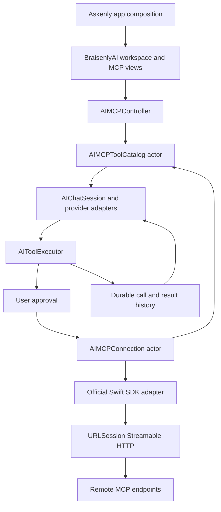

# Mobile MCP tools through BraisenlyAI

Status: proposed design, researched 2026-11-02. Implementation requires design review and the protocol conformance gate below. The companion plan is a proposal, not authorization to ship an unverified SDK candidate.

## Intent and fixed requirements

Askenly on a physical iPad or iPhone connects to remote MCP servers over Streamable HTTP. Reusable connection management, discovery, tool execution, native authentication, and presentation components live in BraisenlyAI, distributed by the existing BraisenlySwiftUI Swift package. Askenly imports and composes these components. Its views do not implement a protocol client.

Use the latest official MCP specification, `2026-07-28` as checked today. Support compatible older remote servers without falsely labeling them current. A pipe transport compiling for iOS does not imply that an iOS app can launch arbitrary stdio server processes. Mobile deployment must not require a shell, local server, package installer, or desktop gateway.

## Existing boundaries

`AskenlyApp` owns `AIChatWorkspaceController`, and `ContentView` embeds `AIChatWorkspaceView`. The library exports `BraisenlyAI` from `Sources/AI` and `BraisenlySwiftUI` primitives separately. Existing MLX client tool-specification/handler injection is a useful seam, but the provider router does not connect it to a tool catalog. Message persistence currently does not represent complete provider tool-call/result relationships. Preserve existing conversation decoding when extending that model.

Pre-merge package/build/cancellation/persistence repairs in the sibling fix worktrees remain prerequisite work; the MCP feature must be rebased onto their reviewed `development` result. This document does not claim those repairs passed or were merged.

## Approaches considered

| Approach | Benefit | Constraint | Decision |
| --- | --- | --- | --- |
| Import official Swift SDK behind a small BraisenlyAI boundary | Native types/concurrency, existing OAuth and transport work, reusable package | Released SDK lags current protocol | Recommended, subject to conformance gate |
| Write JSON-RPC/HTTP/OAuth directly in the app | Full immediate control | Duplicates protocol work and couples Askenly to transport | Reject |
| Route mobile requests through a custom gateway | Could host subprocess servers remotely | Adds an unnecessary service and does not satisfy direct reusable mobile client architecture | Not required |

The official Swift SDK latest release is `0.12.1`; reviewed main still lists `2025-11-25` as newest supported revision. Upstream PR #314 proposes modern support but is open with unverified checks. First evaluate a pinned candidate in an isolated conformance spike. Prefer an official released revision that passes by execution time; otherwise a narrowly maintained upstream patch is an explicit dependency decision, never silently called a stable official release. Merely setting a newer version header fails this design.

## Component ownership

All names below are proposed public interfaces, not existing APIs. Keep SDK-specific types inside the transport adapter; use Foundation `Data` for lossless JSON schema/argument/structured-result payloads at that boundary, validated before use. Introduce additional wrappers only when their responsibilities are distinct.

| Component | Responsibility |
| --- | --- |
| `AIMCPServerConfiguration`, `AIMCPServerStore` | Stable server identity, endpoint, enablement and one authoritative persisted configuration document |
| `AIMCPConnection` actor | SDK adapter for a single remote server: version discovery, requests, notifications, cancellation, auth integration |
| `AIMCPToolCatalog` actor | Paginated discovery, permission-scoped freshness, deterministic tool snapshot and collision-free provider aliases |
| `AIToolDefinition`, `AIToolInvocation`, `AIToolResult` | Provider-independent schema, arguments, complete output blocks, correlation IDs, execution outcome |
| `AIToolExecutor` | One approval-and-dispatch boundary shared by every model adapter and manual tool invocation |
| `AIMCPController` observable model | Main-actor presentation state and user actions; receives connections/catalog/executor by injection |
| `AIMCPConnectionsView`, `AIMCPToolApprovalSheet` | Importable adaptive management and approval components built from existing BraisenlySwiftUI primitives |

Use existing `AIToolCallCard` for lifecycle presentation, extending it only for distinct waiting/denied/cancelled/unknown-outcome states. Keep the complete execution record separate from its display summary. Server-returned data stays associated with its server and invocation across provider history, UI, and persistence.

## Protocol and compatibility contract

Modern requests use per-request version/capability metadata and the corresponding HTTP headers. Modern discovery does not use an initialization handshake or a protocol session identifier. The adapter supports JSON and request-scoped server-sent events, structured tool output, complete/input-required result discrimination, paginated lists and declared caching scope/freshness. Optional change-list subscriptions use the modern listen mechanism. A response requiring additional user input resumes through the specified multi-round-trip exchange, not a fabricated server callback.

Detect legacy behavior only as the specification permits. Authorization failures, transport failure, and malformed responses must not silently downgrade protocol support. Legacy state/initialization belongs inside the adapter; UI displays the actual selected revision. Never add the deprecated separate HTTP+SSE transport as the mobile default. Advertise only capabilities actually implemented; optional Tasks and MCP Apps remain unadvertised unless their contracts are implemented and tested. Their optionality does not permit incomplete core support.

Tool identity is `(serverID, originalToolName)` with a reversible, collision-checked alias per provider. Never route by display name alone. Preserve complete JSON Schema at rest; reject or clearly disable an incompatible schema for a provider instead of silently dropping constraints. Preserve structured JSON, text, image/audio blocks and resource links. A model that cannot consume a result representation gets a documented explicit representation policy; do not silently fetch referenced resources or turn truncated output into a success.

Distinguish protocol error, tool `isError`, user denial, cancellation, and uncertain remote outcome. A disconnected mutation is not automatically replayed. Cancellation closes the modern HTTP operation and tears down the local stream; it does not prove remote rollback. Foreground rediscovery/read-only retries may use bounded backoff; mutating calls require an explicit resolution or retry decision.

## Model execution and context

Model adapters receive a stable enabled tool snapshot and the shared executor. MLX converts definitions into its supported schema format and invokes the existing handler seam; the response loop inserts actual tool results before continuing generation. OpenAI-compatible, Anthropic, and Apple Foundation Models adapters must preserve their own provider call IDs and tool-result roles. Unsupported tool capability is visible to the user; do not claim that all profiles can call every schema.

Persist each invocation with a canonical UUID, conversation/run/turn IDs, provider identity, original provider call ID, server identity, arguments, outcome and content references. Provider call IDs are scoped to conversation/run/turn/provider and may repeat elsewhere; results correlate by the canonical UUID. Decode old conversations with empty optional tool history defaults. Changing models re-renders the same canonical history through that provider's adapter. Changes to server tools invalidate future snapshots; an already proposed invocation is revalidated against the snapshot/authorization the user approved. Bound tool rounds, output size, and concurrent operations through the application's configuration single source of truth.

## Mobile platform contract

- HTTP uses the SDK's URLSession transport and structured cancellation. Do not add low-level sockets, a preflight reachability blocker, or a keepalive timer pretending to grant background execution.
- App-scoped server configuration/auth/catalog can be shared across windows. Conversation runs, approval state and presentation anchors are scene/conversation scoped. Disconnecting one server cancels its operations and subscription without mutating a newer connection generation.
- On background/suspension, persist local outcome state and stop optional subscriptions. Foreground revalidates discovery/auth. A long remote job may continue independently, but recovery needs a server-supported durable Tasks extension and explicit task handle; ordinary SSE is not a durable background job.
- Native OAuth uses `ASWebAuthenticationSession` with a public-client authorization-code flow and proof key for code exchange (PKCE), registered mobile callback, issuer/resource checks and single-flight refresh. No loopback callback listener on the phone. Use an injected token store backed by Keychain; application configuration carries references, not authentication payloads.
- LAN endpoints use their configured hostname, including `adagio.local`, and appropriate local-network usage description/permission. Keep normal transport security. Handle local-network denial, name resolution failure and Wi-Fi-to-cellular changes as distinct actionable states. Internet endpoints continue to work on cellular; LAN-only endpoints cannot magically remain reachable there.
- Treat server descriptions/results as untrusted input. User-visible approval shows actual server, tool and arguments; server annotations cannot authorize execution. Denial or dismissal always completes the pending model operation with a truthful outcome.
- Phone sheets and iPad split/resizable layouts preserve drafts, selection and pending approvals. Include Dynamic Type, VoiceOver, full keyboard access, non-color status and accessible touch targets. Reuse current theme primitives.

## Verified toolchain and framework choices

Report 04 verifies released Swift 6.4.2 and Xcode 27.2 on the check date. Parent Codemunch inspection confirms the fix-worktree manifest uses Swift tools 6.4; preserve its iOS 17/macOS 14 floors. URLSession asynchronous byte streaming and Observation fit those floors. AuthenticationServices typed callback APIs need an availability path for iOS 17.0–17.3. Apple Foundation Models is an iOS 26+ adapter, with iOS 27 external-model features separately gated.

Current upstream MLX exposes an optional `MLXLanguageModel` bridge into Foundation Models using the iOS 27 SDK. It is a possible provider consolidation, not a prerequisite migration for remote MCP. Do not replace the existing MLX handler path solely to gain MCP. Arbitrary MCP JSON Schema to Apple Tool conversion remains a proof obligation; a dynamic-generation schema API does not itself establish that mapping.

## Configuration and settings

Persist editable server configuration once in the app's Application Support document, an equivalent configuration single source of truth. Inject organization-managed defaults from `.env`-derived build configuration; never duplicate endpoint/port literals in views or services. Do not overwrite user configuration each launch. Server enablement, tool allowlists and approval policy are explicit stored settings. The first target server list and deployment-owned OAuth registration values are inputs to implementation, not invented endpoints in this plan.

## Acceptance and release gates

1. Conformance fixtures prove the selected SDK revision's modern core behavior and legacy remote compatibility separately.
2. Deterministic tests cover pagination, alias collisions, schema/result fidelity, authorization changes, multi-round-trip input, malformed events, cancellation and uncertain mutations.
3. Every supported provider completes `model call → user approval → remote tool → persisted result → continued answer`; denial and tool failure are positive negative-test outcomes.
4. Physical iPhone and iPad exercise native sign-in, remote discovery/tool calls, rotation/resizing, background/foreground, network transition, interruption and accessibility. Simulator-only results are not hardware proof. No local model download on largo; use permitted devices and hosted inference as applicable.
5. Axiom networking/concurrency/SwiftUI/AI/accessibility audits, build checks, review-bot findings, append-only run ledger and registered test metrics are complete before release. Native app interaction uses native controls/screenshots; a browser check alone cannot establish iOS behavior.
6. The reviewed feature returns to `development` by pull request, with the prescribed three-number release version and changeset entry. `main` promotion remains a separate verified pull request.

## Evidence and pending decisions

See the four full [research logs](../../research/2026-11-02-mcp/) and [research context](../../research/2026-11-02-mcp/00-research-context.md). Primary references: [official revision](https://modelcontextprotocol.io/specification/2026-07-28), [HTTP](https://modelcontextprotocol.io/specification/2026-07-28/basic/transports/streamable-http), [version compatibility](https://modelcontextprotocol.io/specification/2026-07-28/basic/versioning), [SDK candidate](https://github.com/modelcontextprotocol/swift-sdk/pull/314), [native authentication](https://developer.apple.com/documentation/authenticationservices/aswebauthenticationsession), [local-network privacy](https://developer.apple.com/documentation/technotes/tn3179-understanding-local-network-privacy).

Final SDK revision and imported-source choices require the candidate/license/conformance comparison; first real endpoint and OAuth registration require deployment inputs. Four research reports and the separate builder check informed this proposal. No mobile compatibility or current-framework feature is assumed solely from an SDK README or a search snippet.
